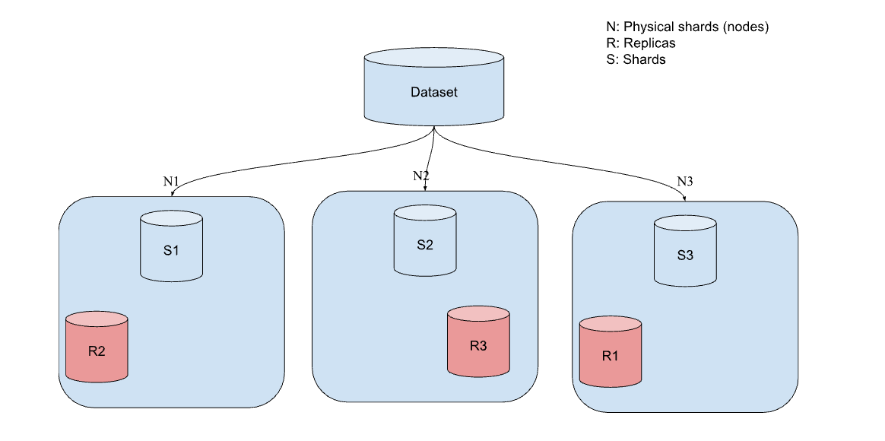
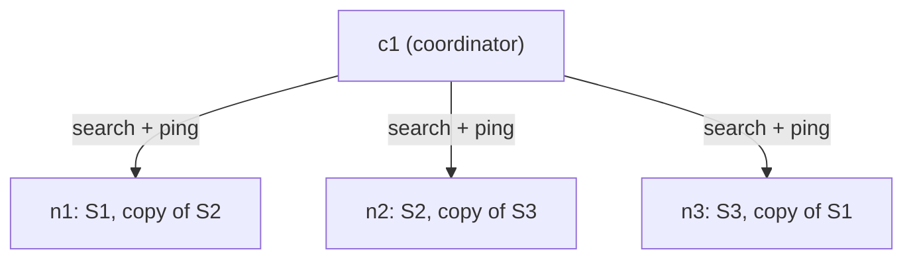
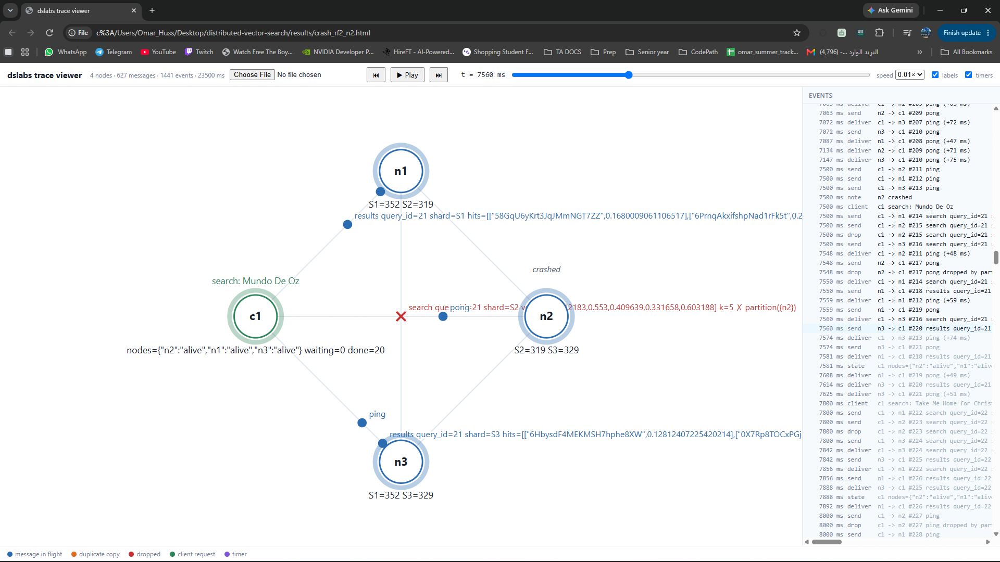
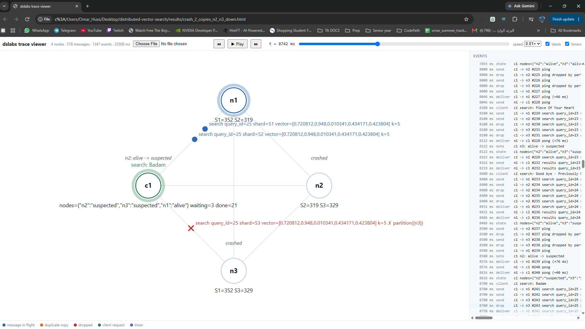
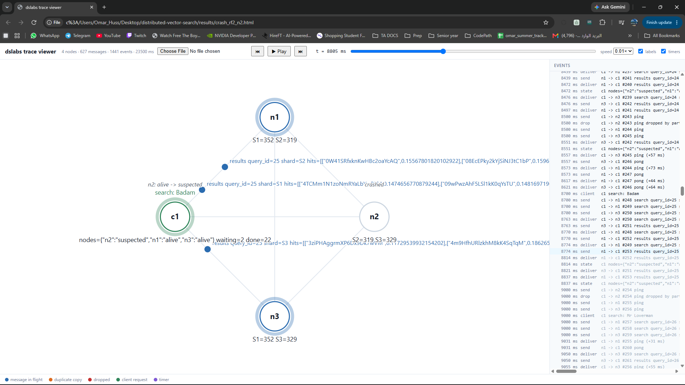
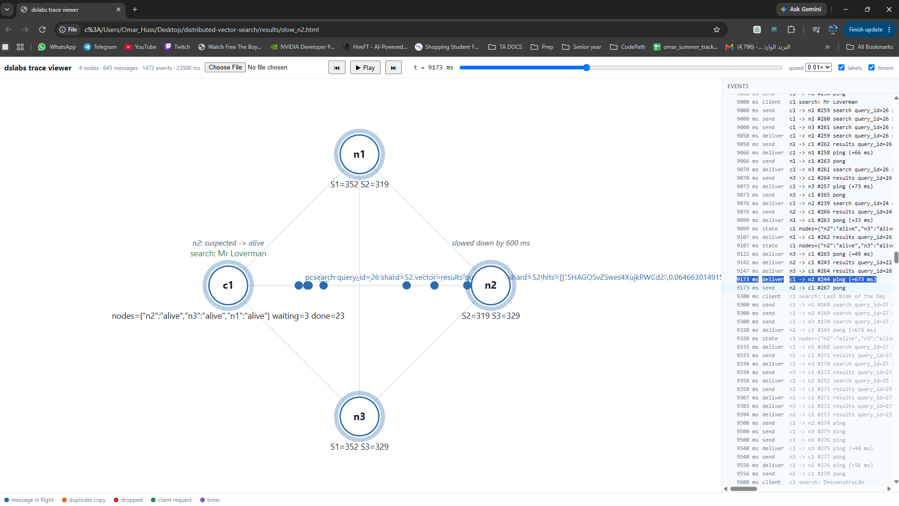
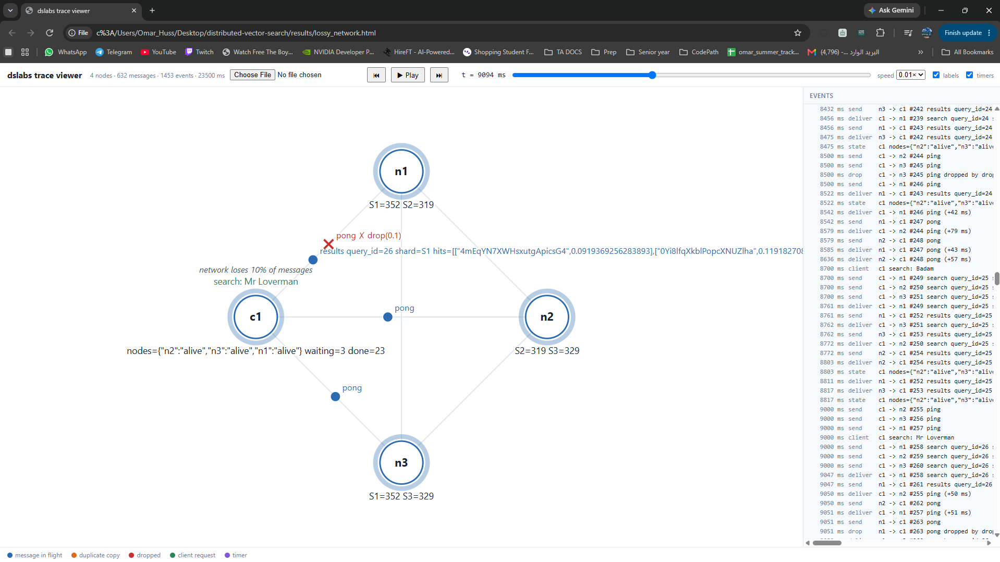

# Distributed Vector Search

This is a vector search system. I am building it to find songs similar to a song that a user looks for. The songs are split into shards, and each node holds one shard plus a replica of another node's shard, so the search keeps working when some of those nodes fail.

As for now, the sample I used is a small set of songs, 1000 for look up and 20 to build the queries. The full system is also a small one, with one coordinator and 3 other nodes.

## How it works

Every song is a vector of five audio features: danceability, energy, acousticness, valence, and tempo. Two songs whose vectors are similar/close should be returned, that's it --> finding similar songs means finding the closest vectors.

Songs were split into three shards. Each shard lives on two nodes, a primary and a replica on a different node, so no shard depends on one machine. The nodes that hold the songs are storage nodes. Each one keeps its shards and, when the coordinator asks, searches only its own songs and sends back its top 5. This is the initial phase that was in my diagram, and it was improved to survive worse cases (e.g., more than one machine is down and marked dead by the coordinator).



A coordinator takes each query and sends it to one live copy of every shard. Each shard returns its own 5 closest songs, and the coordinator merges them into one final top 5 (for now). The merge gives the right answer because any song in the global top 5 has to be in its own shard's top 5.



The coordinator also pings every node every 500 ms. If a node is silent for 1 second, the coordinator suspects it and sends that shard's queries to the replica instead. If it is silent for 2 seconds, it marks the node dead. It can't tell a slow node from a dead one, since both are just silent, so the suspected stage gives a node a chance to come back before it is written off.

I used the [dslabs](https://github.com/cscheffler/dslabs) library from the first couple of classes as the simulator, and built the whole search system on top of it: the nodes, sharding, replicas, failure detection, and the failure experiments. Every failure replays the same way from its seed, and I used the dslabs viewer to watch each of my scenarios in the browser: the queries going out, the dropped messages, and the nodes changing status.

## Install

You need Python 3.10 or newer.

```bash
python -m venv .venv
.venv\Scripts\activate          # Windows
source .venv/bin/activate       # Mac/Linux
pip install -r requirements.txt
```

On Windows, run `$env:PYTHONUTF8 = "1"` first. dslabs reads its viewer file as UTF-8, and Windows doesn't by default, so saving the viewer crashes without it.

## Data

I used the [Spotify Tracks Dataset](https://huggingface.co/datasets/maharshipandya/spotify-tracks-dataset). To get the data, download `dataset.csv` (Files and versions tab), put it in `data/raw/dataset.csv`, and run:


```bash
python -m scripts.prepare_data
```

The script removes duplicate songs (the same song shows up once for every genre it is listed under), scales the features to 0 to 1, and picks 1,000 songs for the cluster and 20 other songs as test queries. For each query it finds the true 5 closest songs by comparing it with all 1,000 songs on one machine, and I use these as the answer key to check the cluster against. To confirm the answer key itself is right, I checked one distance by hand, and a test computes the same top 5 a second way (with numpy) and makes sure they match.

## Quick start

```bash
python -m scripts.run_queries
```

This runs a cluster of one coordinator and three storage nodes and sends the 20 test queries through it. For each query, it counts how many of the 5 returned songs are in the answer key, then prints the average as recall@5, where 1.00 means every query got all 5 right. With no failures I get 1.00, so splitting the songs across three nodes gives the same answers as searching all of them on one machine.

It also saves `results/first_run.html`. Open it in a browser and press Play to watch every query go out to the nodes and the answers come back.

To run the tests:

```bash
python -m pytest
```

## Breaking it

### Crashes

```bash
python -m scripts.run_crash
```

This script runs the 20 test queries in three rounds: first with all nodes working, then again while one or two nodes are crashed, and then again after nodes' recovery. A crash cuts the node off from the network, so every message to it or from it is dropped.



| Copies of each shard (replication factor) | Crashed nodes | Recall, all nodes up | Recall, during the crash | Recall, after recovery |
|---|---|---|---|---|
| 1 | n2 | 1.00 | 0.65 | 1.00 |
| 2 | n2 | 1.00 | 0.95 | 1.00 |
| 2 | n2, n3 | 1.00 | 0.64 | 1.00 |
| 3 | n2, n3 | 1.00 | 0.85 | 1.00 |

The three cases (1, 2, and 3 copies) are: each node holds only one shard, each node holds one shard and a replica of another, and each node holds one shard along with replicas of the other two. The table shows how well the system tolerates dropped nodes in each case.

For example, with 1 copy and n2 crashed, recall drops to 0.65. n2 is the only node holding S2, which has around 319 of the 1,000 songs. While n2 is down, the cluster still returns 5 songs for every query, but only from S1 and S3. Whenever some of the true 5 songs are in S2, they are replaced by worse matches from the other shards, so 5 songs returned yes, but worse matches.

With 2 copies and both n2 and n3 crashed, recall falls to 0.64 for the same reason. S3 is stored on n3 (primary) and n2 (replica), so with both of them down there is no copy of S3 left, and its songs are missing just like S2's songs were in the first row.



With 2 or 3 copies, recall still drops a bit during the crash, and that comes from timing, not from missing data. Right after a crash, the coordinator doesn't know about it yet: it only suspects a node after 1 second without an answer to its pings. In that first second it keeps sending queries to the crashed node, and those queries wait for the 1 second timeout and come back without that shard's songs. As soon as the node is suspected, the coordinator sends to the replica instead, and the rest of the queries get all 5 songs.



### Other failures

```bash
python -m scripts.run_other_failures
```

This uses 2 copies of each shard and the same three rounds as the crash test, but instead of crashing a node, it causes a different failure in the middle round.

| Failure | Recall, all nodes up | Recall, during the failure | Recall, after it's fixed |
|---|---|---|---|
| n2 slow (every message to or from it takes 600 ms longer) | 1.00 | 0.65 | 1.00 |
| 10% of all messages lost at random | 1.00 | 0.76 | 1.00 |

The slow node is the result I didn't expect. n2 still answers the pings, only late, so the coordinator thinks it is alive most of the time and keeps sending it S2's queries. But a search to n2 and back now takes about 1.3 seconds, longer than the 1 second timeout, so S2 counts as missing on almost every query, even though n1 holds a full copy of S2. That's why recall drops to 0.65, the same as having no replica at all. The heartbeats only check that a node answers, not that it answers in time.



With 10% of messages lost, each shard's answer needs two messages to arrive: the query going out and the result coming back. About 1 in 5 shard answers never arrives, so recall drops to 0.76.



Both failures have the same fix: when a shard times out, ask its other copy right away instead of giving up. I haven't built it yet.

## How it fits together

| Where | What |
|---|---|
| `scripts/prepare_data.py` | Raw CSV to song vectors, test queries, and the answer key |
| `scripts/run_queries.py` | Runs the test queries through the cluster and measures recall |
| `scripts/run_crash.py` | Crashes nodes with 1, 2, or 3 copies of each shard and measures recall |
| `scripts/run_other_failures.py` | A slow node and a lossy network |
| `src/similarity.py` | Distance and brute-force top-k, used by everything that ranks songs |
| `src/storage_node.py` | `StorageNode`: holds shards and answers searches with its local top-k |
| `src/coordinator.py` | `Coordinator`: picks a live copy of each shard, merges the replies, times out on silent shards, tracks nodes with heartbeats |
| `src/cluster_setup.py` | Builds the cluster, splits the songs into shards, and places the copies |
| `src/faults.py` | Crash, recover, slow down, and lose messages |
| `src/metrics.py` | recall@k |
| `tests/` | Tests for each of the above |

## Normalization

I scale every feature with min-max: (value - min) / (max - min), so each one goes from 0 to 1. The only reason this was needed is that four of the features are already between 0 and 1, but tempo goes up to 243. If I left it as it is, it would decide almost every distance by itself. I chose min-max for two reasons: it is linear, so it keeps the shape of the data, and I knew it from CS156 (ML course). Whichever scaling I pick, the distributed part stays correct, since the answer key uses the same scaled vectors as the nodes.

The issue is that some tracks have a tempo of 0 (silence or noise), and that stretches the range. Most real songs end up between 0.25 and 0.82 on tempo, so tempo counts a bit less than the other features.

The alternatives I want to compare next:

1) Clipped min-max: cut the extreme values first (1st to 99th percentile), then min-max.
2) Z-score: (value - mean) / std. It is standard in ML, but it isn't bounded to 0 to 1.
3) Robust scaling: (value - median) / IQR. It ignores outliers, but it isn't bounded either.
4) Sigmoid: z-score, then 1 / (1 + e^-z), the same logistic function from logistic regression in CS156. It is bounded and squashes outliers, but it is not linear, so it bends the distances, and I need to understand it better to know if it fits here.
5) Quantile: every value becomes its percentile. Outliers stop mattering, but I lose how big the differences are.

To compare them, I will use genre as a checker at the end. The search itself only uses the five audio features, and genre is only looked at after the search is done:

1) For each test query, take the 5 songs the search returns.
2) Count how many of them have the same genre as the query (from 0 to 5).
3) Average that count over all 20 queries.
4) Repeat for each normalization method. The method with the highest average finds songs that are more alike.

I didn't put genre inside the vectors because it is a label, not a number. To turn it into numbers, every genre becomes its own column, with a 1 for the song's genre and 0 for the rest, and those 1s would outweigh the small differences in the audio features, so genre would decide the matches instead of the sound. It also couldn't be a fair check anymore if the search already used it.


## Next to work on

1) Writes: right now the songs are loaded once at the start and never change. I missed this in my proposal and it came up in the feedback, so I'll add uploading and deleting songs while the system runs, with every write going to the primary and then copied to its replica.
2) A second coordinator: there is only one now, so if it crashes, the whole search stops.
3) Retrying on the other copy: when a shard doesn't answer in time, ask its replica right away instead of giving up. That fixes the queries lost in the second before a crashed node is suspected, and the slow node, whose answers keep arriving too late.
4) Running the nodes as real separate processes instead of inside the simulator. The deterministic tests were only for this phase, because the same seed gives the same run, so I could replay a failure to see why it happened and compare scenarios fairly, but with real processes I can test real failures, like killing a process, and not only simulated ones.
5) Approximate nearest neighbor search (ANN) on each shard, with all 89,740 songs instead of 1,000.

## AI use

I used Claude to plan the iterations, explain the concepts I was new to, and draft the code, which I typed in myself, read through, and tested. This README started from a draft by Claude that I then rewrote. 